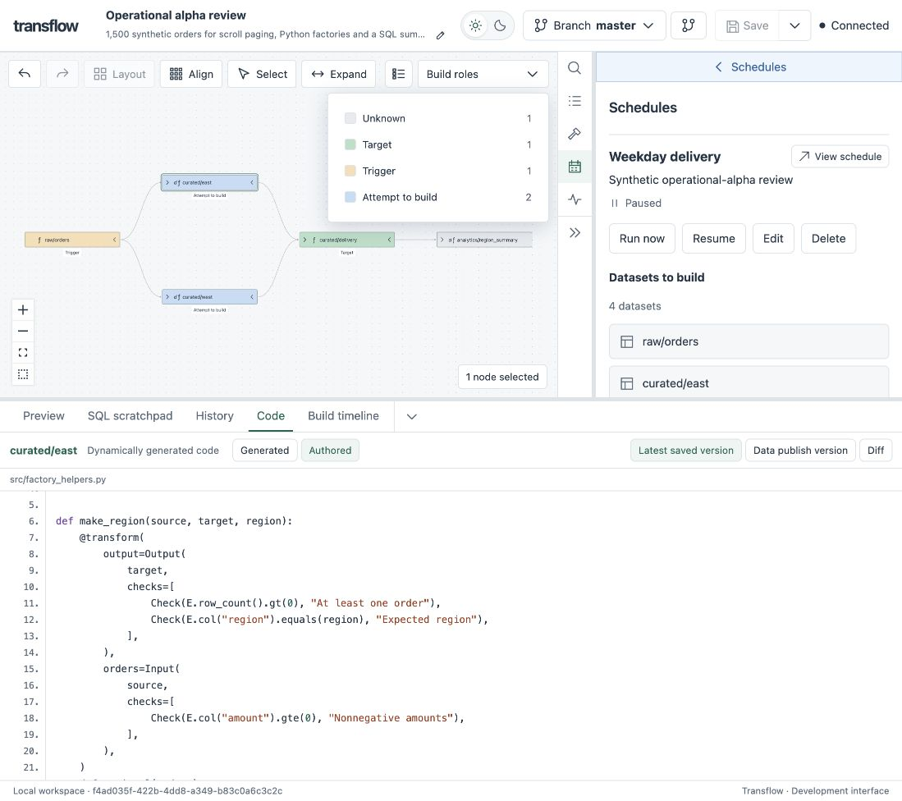

I started building **transflow** back in 2022 as a pet project for my own use. Recently, I decided that it was a good base for experimenting with agentic coding to validate if a closely guided agent can produce production software.

Transflow allows you to write transforms in **Polars or DuckDB SQL**, build versioned datasets, and explore
how they connect in an interactive lineage UI. Transflow brings execution,
data quality, history and scheduling into one local workflow.

[](https://github.com/jmsmistral/transflow/actions/workflows/rust.yml)
[](https://github.com/jmsmistral/transflow/actions/workflows/python.yml)
[](https://github.com/jmsmistral/transflow/actions/workflows/web.yml)
[](https://github.com/jmsmistral/transflow/actions/workflows/safety.yml)



**[Get started](docs/getting-started.md)** · **[Documentation](docs/README.md)** · **[Try the SQL example](examples/sql-checks/README.md)**

Author with [local editor assistance](docs/editors.md), then manage retained data
with [explicit, previewable garbage collection](docs/retention.md).

## Your code, connected

Declare the data a transform reads and the dataset it produces. Transflow resolves
its dependencies and manages execution, checks and publication.

```python
import polars as pl
from transflow import Input, Output, transform


@transform(
    output=Output("curated/order_totals"),
    orders=Input("raw/orders"),
)
def order_totals(orders: pl.LazyFrame) -> pl.LazyFrame:
    return orders.group_by("customer_id").agg(pl.col("amount").sum())
```

Prefer SQL? Keep the declaration and query together with
[`sql_transform`](python/SQL_TRANSFORMS.md):

```python
from transflow import Input, Output, sql_transform


@sql_transform(
    output=Output("curated/order_totals"),
    orders=Input("raw/orders"),
)
def order_totals():
    return "SELECT customer_id, SUM(amount) AS amount FROM orders GROUP BY customer_id"
```

## Features

- **Pipeline development and orchestration** - Review build inputs, checks and execution limits, then run or schedule data pipelines.
- **Polars and DuckDB first** - Write data transformations in Polars or DuckDB SQL.
- **Versioned data and provenance** - Track published outputs, captured code and exact input versions.
- **Data expectations** - Define and validate quality checks on transform inputs and outputs.
- **Reusable transform factories** - Generate Python and SQL transforms from shared definitions, with optional dataset metadata handles.
- **Lineage UI** - Explore pipelines and dataset metadata via an interactive graph with informative overlays and live build status.
- **Interactive exploration** - Preview, filter and sort dataset rows, join catalog datasets with SQL autocomplete and inspect authored/generated code and execution history.
- **Branch fallbacks** - Resolve inputs through an ordered set of data branches for builds and scheduled runs.
- **Data health** - Review recent builds and open individual input and output check results.
- **Editor assistance** - Complete dataset references, inspect catalogue metadata and navigate to producers from your editor.
- **Build caching** - Reuse eligible results to avoid unnecessary computation.
- **Local ownership** - Keep pipeline code, data and execution on your machine.

The transflow coordinator runs locally. SQLite stores metadata and immutable Parquet files
hold the data. External workspace inputs are read under leases; their producer
code stays in the provider's workspace.

## Try it

**Developer preview · Python 3.14.** Start with the
[source quickstart](docs/getting-started.md) to build the CLI, prepare the Python
environment and create a runnable example. The public PyPI release is still ahead.

With the quickstart's customer-orders workspace prepared:

```bash
transflow --workspace "$HOME/transflow-demo" plan curated/customer_orders --mode full
transflow --workspace "$HOME/transflow-demo" build curated/customer_orders --mode full

# From the repository checkout: build and open the lineage workspace.
bash tools/serve-review.sh "$HOME/transflow-demo" --open
```

Select a dataset to inspect its values and producing code. Run a scratchpad SQL
query with Cmd+Enter (Ctrl+Enter on other platforms), open a previous build, or
follow its upstream dependencies. Saved lineage views keep the graph you are working with.

## Explore more

- **[Getting started](docs/getting-started.md)** - from source checkout to your first build and browser workspace.
- **[Write Python transforms](python/DECLARATIONS.md)** · **[Write SQL transforms](python/SQL_TRANSFORMS.md)** · **[Add quality checks](python/EXPECTATIONS.md)**.
- **[Reuse transform factories and dataset handles](python/TRANSFORM_FACTORIES.md)**.
- **[Build and inspect datasets](crates/transflow/BUILDS.md)** · **[Set up schedules](crates/transflow/SCHEDULES.md)**.
- **[Browse all guides](docs/README.md)** - authoring, operations, UI and API reference.
- **[Contribute](docs/development/README.md)** - source layout, setup and verification.

Transflow is under active development. The current preview uses a native Rust CLI,
a matched Python SDK/worker wheel, and a separately built web UI. See the
[quickstart](docs/getting-started.md) for the supported setup today.
