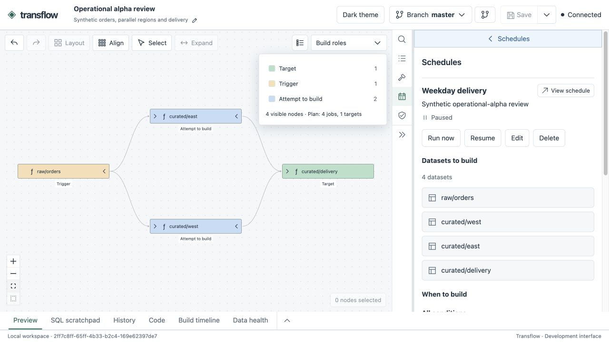

# Transflow

### Build data pipelines locally. Understand every result.

Write transforms in **Polars or DuckDB SQL**, build versioned datasets, and explore
how they connect in an interactive lineage workspace. Transflow brings execution,
data quality, history and scheduling into one local workflow.

[](https://github.com/jmsmistral/transflow/actions/workflows/rust.yml)
[](https://github.com/jmsmistral/transflow/actions/workflows/python.yml)
[](https://github.com/jmsmistral/transflow/actions/workflows/web.yml)
[](https://github.com/jmsmistral/transflow/actions/workflows/safety.yml)



**[Get started](docs/getting-started.md)** · **[Documentation](docs/README.md)** · **[Try the SQL example](examples/sql-checks/README.md)**

Author with [local editor assistance](docs/editors.md), then manage retained data
with [explicit, previewable garbage collection](docs/retention.md).

## Your code, connected

Declare the data a transform reads and the dataset it produces. Transflow resolves
its dependencies and manages execution, checks and publication.

```python
import polars as pl
from transflow import Input, Output, transform


@transform(
    orders=Input("raw/orders"),
    output=Output("curated/order_totals"),
)
def order_totals(orders: pl.LazyFrame) -> pl.LazyFrame:
    return orders.group_by("customer_id").agg(pl.col("amount").sum())
```

Prefer SQL? Register a captured SQL file with named input views using
[`sql_transform`](python/SQL_TRANSFORMS.md):

```sql
SELECT customer_id, SUM(amount) AS amount
FROM orders
GROUP BY customer_id;
```

## From a build to an explanation

| Capability                   | What you get                                                                                              |
| ---------------------------- | --------------------------------------------------------------------------------------------------------- |
| **Polars and DuckDB**        | Python transforms and SQL transforms in the same dataset graph.                                           |
| **Versioned data**           | Immutable Parquet outputs, captured source and exact input-version provenance.                            |
| **Quality checks**           | Input and output checks, with the last successful output preserved when a required check fails.           |
| **Branches and caching**     | Separate data branches, ordered input fallbacks and reuse of eligible results.                            |
| **An interactive workspace** | Explore dataset lineage, preview tables, query published data and inspect code, logs and build timelines. |
| **Schedules**                | Run on time or publication events, combine conditions and inspect recent runs.                            |

The coordinator runs locally. SQLite stores metadata and immutable Parquet files
hold the data. External workspace inputs are read under leases; their producer
code stays in the provider's workspace.

## Try it

**Developer preview · Python 3.14.** Start with the
[source quickstart](docs/getting-started.md) to build the CLI, prepare the Python
environment and create a runnable example. The public PyPI release is still ahead.

With the quickstart's customer-orders workspace prepared:

```bash
transflow --workspace "$HOME/transflow-demo" plan curated/customer_orders
transflow --workspace "$HOME/transflow-demo" build curated/customer_orders

# From the repository checkout: build and open the lineage workspace.
bash tools/serve-review.sh "$HOME/transflow-demo" --open
```

Select a dataset to inspect its values and producing code. Run a scratchpad SQL
query, open a previous build, or follow its upstream dependencies. Saved lineage
views keep the graph you are working with.

## Explore more

- **[Getting started](docs/getting-started.md)** — from source checkout to your first build and browser workspace.
- **[Write Python transforms](python/DECLARATIONS.md)** · **[Write SQL transforms](python/SQL_TRANSFORMS.md)** · **[Add quality checks](python/EXPECTATIONS.md)**.
- **[Build and inspect datasets](crates/transflow/BUILDS.md)** · **[Set up schedules](crates/transflow/SCHEDULES.md)**.
- **[Browse all guides](docs/README.md)** — authoring, operations, UI and API reference.
- **[Contribute](docs/development/README.md)** — source layout, setup and verification.

Transflow is under active development. The current preview uses a native Rust CLI,
a matched Python SDK/worker wheel, and a separately built web UI. See the
[quickstart](docs/getting-started.md) for the supported setup today.
